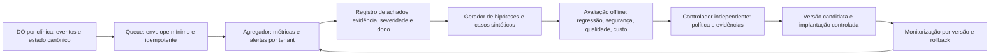

# Avaliação e melhoria contínua do atendimento conversacional

**Estado:** direção de autonomia desde a arquitetura inicial **Confirmada** pela DEC-084 (Paulo, 31/10/2026). KPIs, contratos técnicos e política operacional detalhada permanecem **Propostos**. Implementação, ativação e uso de dados reais dependem dos critérios abaixo. A origem é o pedido do Paulo em 31/10/2026 para avaliar conversão, frustração, intervenção humana, segurança e consumo de IA/WhatsApp. O [épico #1](https://github.com/intentzero/tredane/issues/1) encerrou a definição documental do MVP e transferiu hipóteses; esta proposta não reabre nem amplia silenciosamente aquele recorte.

**Confirmado, preservado aqui:** DEC-011 (contexto mínimo e provedor), DEC-038 (SQLite operacional por clínica), DEC-046 (respostas baseadas no cadastro e limites de saúde), DEC-061 (marcação só pelo botão de proposta versionada), DEC-067 (imagens fora da IA) e DEC-083 (pedido humano e saída do agendamento pausam IA até a equipe devolver). Ver [decisões](../product/decisions.md), [modelo híbrido](conversational-hybrid-model.md) e [fronteira de contexto](../security/ai-context-minimization.md). A divergência sobre **quem envia a sugestão** (NC-01) e a ampliação de contexto (NC-02) permanecem **Em aberto** no [registo AIMS](../security/aims-register.md). Toda métrica abaixo distingue sugestão, mensagem efetivamente enviada e ação de agendamento.

## Objetivo e princípio de controle

**Proposto:** melhorar o resultado *por atendimento elegível*, sem otimizar conversão ou custo à custa de reclamações, pressão sobre a cliente, erro de agenda, perda de acesso humano, privacidade ou segurança. “Auto-organizado” significa que o sistema recolhe sinais, agrupa falhas, prioriza hipóteses, gera candidatos e executa avaliações sintéticas de forma repetível. Nenhum modelo, avaliador, métrica ou agente se autoriza a mudar prompt, contexto, fornecedor, limites, envio, preço, agenda, Pix, dados ou política de segurança em produção.

**Confirmado (DEC-084):** o ciclo inclui promoção autónoma desde o desenho inicial. Paulo autoriza previamente uma política delimitada; cada melhoria dentro dela é avaliada e promovida pelo controlador sem aprovação humana individual. Mudanças fora da política exigem nova decisão. Observação e contenção operacional seguem os controles aprovados. Em incidente, pode pausar a capacidade afetada e encaminhar à equipe se o caminho estiver previamente aprovado; nunca “corrigir” um defeito relaxando validações ou apagando evidência.

## Unidade de análise e eventos

**Proposto:** unidade principal = episódio de agendamento de um contato, numa clínica e conversa, iniciado por intenção de marcar e encerrado por confirmação, desistência explícita ou fim de uma janela de observação. A transferência humana muda o caminho do episódio, mas não o encerra: um agendamento posterior pela equipe continua a contar como conversão assistida. A janela (ex.: 7 dias), a regra de novo episódio e a elegibilidade precisam de validação com a clínica piloto. Um contato pode ter vários episódios; um único botão reenviado por webhook não cria dois resultados. Segmentos mínimos: clínica, serviço/variante, origem da conversa, horário comercial ou não, modalidade com/sem sinal, caminho com sugestão/automático/humano e versão da política. Não segmentar por sexo inferido, saúde ou outros dados sensíveis.

Eventos de domínio, emitidos **após persistência** no SQLite do DO da clínica, com `event_id`, `tenant_id` interno, `conversation_id`, `episode_id`, `occurred_at`, `correlation_id`, `policy_version`, `source` e chave de idempotência:

| Família | Eventos relevantes | Regra de medição |
| --- | --- | --- |
| Entrada e intenção | mensagem recebida, intenção de agendar, pedido de pessoa, desvio de assunto | Distinguir mensagem do webhook reentregue; intenção inferida tem versão e incerteza. |
| IA | chamada iniciada/concluída/falhou, sugestão criada/rejeitada/editada, aviso de segurança, pausa/devolução | Registrar modelo, tokens, duração e categoria; nunca prompt ou resposta no fluxo analítico. |
| WhatsApp | intenção de envio, aceite pela Meta, entrega, falha, estado incerto, resposta da cliente | Aceite pela Meta não é entrega; retry incerto não conta como mensagem nova entregue. |
| Proposta e agenda | proposta criada/enviada/expirada, botão válido/inválido, Pix iniciado/pago, compromisso confirmado/recusado/cancelado | Conversão só com compromisso confirmado; clique e Pix sem vaga não são sucesso. |
| Equipe | pedido humano pela cliente, transferência por regra, intervenção corretiva, edição, assumir/devolver à IA, resolução | Separar intervenção desejada da intervenção causada por falha da IA. |
| Segurança e custo | tentativa de injeção, bloqueio/rejeição, incidente confirmado, consumo medido por fornecedor | Contar achado, triagem e incidente confirmado separadamente. |

**Proposto:** o DO guarda eventos operacionais e projeções do episódio no escopo da clínica. Uma Queue recebe um envelope mínimo, assinado/interno e idempotente para agregação; o consumidor revalida tenant, versão e finalidade. D1 central mantém somente configuração administrativa e, se aprovado, agregados por clínica/período sem conversa ou texto. Comparações entre clínicas só em agregados com limiar mínimo de amostra a definir. Nenhum evento analítico é transmitido pelo WebSocket a outra clínica. R2 continua privado; anexos não entram na avaliação automática. Workflows podem coordenar lotes e revisão, mas revalidam tenant e capacidades antes de qualquer efeito. A arquitetura detalhada de isolamento permanece em [tenant-boundaries.md](../product/tenant-boundaries.md).

## KPIs propostos

Cada painel mostra numerador, denominador, janela, amostra, versão, intervalo de confiança quando aplicável, atraso de dados e estratos; não publica um “score” único que esconda regressão de segurança. Métricas de frustração ou intenção inferida são **sinais**, com auditoria amostral humana e taxa de desacordo.

| KPI | Definição operacional proposta | Leitura e risco de interpretação |
| --- | --- | --- |
| Conversão em agendamento | Episódios elegíveis iniciados numa coorte e confirmados até ao fim da janela de atribuição ÷ todos os episódios elegíveis iniciados nessa coorte, depois de a janela amadurecer. Reportar também tempo até confirmação e conversão assistida por humano. | Atribuir por episódio, nunca pelo último texto do modelo; manter casos sem horário ou com falha de canal no resultado global e apresentar esses segmentos separadamente. Elegibilidade é fixada antes de observar o resultado; episódios ainda em observação aparecem como pendentes. |
| Frustração da cliente | Mostrar cada sinal observável separadamente por episódio. Estimar prevalência de frustração como episódios rotulados pela revisão humana ÷ episódios da **amostra auditada**, com intervalo de confiança e método de amostragem. | Classificador não diagnostica emoção. Pedido humano pode ser preferência legítima; não deve ser tratado como erro nem como algo a suprimir. |
| Intervenção humana evitável | Episódios em que a equipe corrigiu dado factual, preço, horário, proposta ou resposta da IA ÷ episódios com assistência da IA. Registrar minutos estimados de trabalho por categoria. | “Falar com a equipe”, saúde, cancelamento, terceiro, abuso e outros handoffs exigidos pela DEC-083 são **adequados**, não falhas. Medir taxa de handoff adequado em separado. |
| Segurança da marcação | Marcações indevidas, duplicadas, sem botão válido, fora da disponibilidade ou com preço errado por 1.000 marcações automáticas; contagem absoluta sempre visível. | Qualquer caso confirmado é incidente/gate, mesmo que a taxa agregada pareça baixa; preservar o critério de 20 marcações revistas da DEC-061. |
| Qualidade factual | Respostas enviadas com afirmação sobre preço, serviço, duração, horário ou política sem correspondência ao cadastro vigente ÷ respostas auditadas. | Auditar amostra estratificada e todos os avisos; distinguir erro do modelo, contexto e validador. |
| Conclusão sem atrito | Episódios com agendamento confirmado sem correção, repetição ou transferência evitável ÷ elegíveis; mediana e p95 de turnos e tempo até resolução. | Não “ganhar” encurtando a conversa à força ou omitindo informação necessária. |
| Acesso humano | Pedidos humanos atendidos dentro do prazo definido ÷ pedidos humanos; tempo até primeira ação da equipe e casos perdidos. | Guardrail: reduzir chamadas humanas nunca pode dificultar a DEC-083. |
| Confiabilidade do canal | Propostas e resultados entregues ÷ tentativas definitivas; pendências >5 min, falhas, estados incertos e webhooks duplicados. | Usar estados Meta reais; não confundir solicitado, aceito e entregue. |
| Eficiência IA | Custo e tokens por episódio elegível, por compromisso confirmado e por resposta útil; chamadas por episódio, p50/p95 de latência, timeout, retrabalho e fallback. | Custo por conversão sozinho favorece excluir casos difíceis. Comparar também qualidade e acesso humano por segmento. |
| Eficiência WhatsApp | Mensagens cobradas por episódio/compromisso, templates por categoria, envios duplicados, mensagens sem resposta útil e custo reconciliado com a fatura Meta. | Regras e preços do provedor mudam; não inferir custo de `message_sent` antes da reconciliação. |
| Defesa e privacidade | Incidentes confirmados por severidade, tempo até detectar/conter/corrigir, taxa de bypass nos testes adversariais, vazamento entre tenants, cobertura dos testes e falhas de exclusão. | Zero incidentes observados não prova segurança; medir cobertura e capacidade de detecção. |

**Métrica orientadora proposta:** conversão confirmada e sem erro **com** satisfação/acesso humano preservados. **Guardrails obrigatórios propostos:** zero marcação indevida nos conjuntos de regressão e nos 20 casos do piloto já definidos, zero vazamento de tenant/segredo conhecido, nenhuma piora material no acesso humano, nenhum aumento material de frustração/falha de entrega. Limiares estatísticos, prazos de atendimento e custo máximo são **Em aberto**; não inventar metas numéricas antes da linha de base.

## Arquitetura do ciclo

1. **Coleta e projeção — Proposto.** Instrumentar transições existentes, sem copiar corpos de conversa para telemetria. Atribuir chamada e envio ao episódio/versão. Resolver atraso e reentrega antes do agregado. Para uma classificação de frustração, preferir marcação humana amostral; se houver classificador, executar sob o mesmo controle de privacidade da IA, guardar só rótulo/versão/incerteza, e medir precisão e viés por tipo de caso. Não criar uma nova chamada de LLM por mensagem só para medir.
2. **Detecção e diagnóstico — Proposto.** Regras determinísticas para invariantes (dupla marcação, preço fora de cadastro, botão inválido, isolamento, exclusão, sequência Meta, gasto, latência). Detecção estatística apenas sugere anomalia; correlacionar com deploy, versão de prompt/modelo, catálogo e incidentes de canal. Um classificador ou agente pode agrupar casos e redigir hipótese sem PII; severidade e causa permanecem verificadas por pessoa.
3. **Criação de candidato — Proposto.** Uma ficha por hipótese: evidência, mecanismo causal, mudança mínima, métricas esperadas, guardrails, custo máximo, plano de teste, responsável e reversão. Ordem típica: corrigir regra/validador ou dado do catálogo → ajustar fluxo determinístico → reduzir contexto e chamadas → só então testar prompt/modelo. Não treinar ou ajustar pesos com conversas da clínica; [AIMS](../security/aims.md) exclui treino de modelo próprio do MVP.
4. **Avaliação — Proposto.** Replay **sintético ou autorizado e minimizado** de jornadas normais e adversariais, incluindo duas clínicas, conversas paralelas, reentrega, botão expirado, Pix sem vaga, desconexão, pedido humano, injeção e saída fora de esquema. Congelar conjunto de regressão, incluir novos incidentes como casos sintéticos e manter conjunto oculto para evitar ajuste apenas ao benchmark. Revisão humana cega das amostras mede fatos, tom, frustração, handoff correto e casos difíceis. Toda comparação registra versão e custo total, inclusive da própria avaliação.
5. **Promoção e acompanhamento — Proposto.** Para mudanças já aprovadas e de baixo risco, testar em sombra (sem enviar nem marcar), depois canário por tenant consentido com reversão e monitorização de guardrails. Randomizar por episódio/contato persistente, nunca alternar política dentro da mesma conversa; amostras pequenas pedem decisão qualitativa. Mudança que amplia dados, autonomia, canal, preço/custo estratégico ou risco exige DEC/ADR e aprovação do Paulo antes de ativação. Reversão não cancela compromissos existentes; apenas impede novos efeitos e encaminha à equipe.

### Segurança: detectar, conter, corrigir e provar

Modelo de ameaças e critérios verificáveis: [segurança da evolução autónoma](../security/evolucao-autonoma-threat-model.md). EA-R01–15 ligam riscos a controles e testes; EA-G01–06 bloqueiam ativação enquanto não houver evidência. **Estado:** análise documental; testes e controles ainda não comprovados.

**Proposto:** um ciclo de segurança próprio recebe sinais do CI, testes adversariais, telemetria, revisão de código, denúncias da equipe e incidentes do provedor. Classifica por impacto e confiança; em caso de suspeita crítica, aplica pausa já autorizada e preserva IDs, versões e trilha sem conteúdo sensível desnecessário. A correção vai à causa: autorização no backend, validação transacional, isolamento, sanitização, versão da proposta, segredo, rate limit ou política de envio. Um prompt mais restritivo é defesa complementar, nunca substitui esses controles. Executar novamente o ataque e testes de não regressão antes de resolver o achado. Ver [prompt-injection.md](../security/prompt-injection.md), [S9](../security/seg-ia-s9-e2e-validation.md) e [runbook de incidente](../implementation/runbooks/incidents.md).

**Proposto para laboratório:** agente pode preparar patches e testes num ambiente isolado, sem credenciais nem acesso à produção. **Fora do MVP nesta proposta:** mesclar ou implantar esses patches automaticamente, alterar dashboard, migrar dados, trocar fornecedor ou mudar orçamento sem autorização. A detecção pode gerar uma correção candidata e evidência para revisão; não recebe credenciais de produção nem dados de outras clínicas.

### Eficiência de IA e WhatsApp

**Proposto:** antes da chamada de IA, usar intenção/estado e catálogo para decidir se há trabalho novo. DEC-083 já permite frase fixa e pausa sem modelo; eventos repetidos, webhook reentregue e pedido durante pausa não geram nova inferência. Limitar histórico ao contexto aprovado (NC-02 ainda aberta), deduplicar jobs, colocar orçamento por tenant e tipo de tarefa, e comparar modelos/limites de tokens com qualidade por segmento. Cache de respostas personalizadas não é permitido enquanto não houver prova de isolamento e política aprovada; o inventário atual pede `cf-aig-skip-cache: true`.

No WhatsApp, usar outbox/idempotência, esperar estado de envio antes de retry incerto, juntar informação necessária numa proposta determinística clara, evitar perguntas redundantes e respeitar a janela e templates aprovados. Medir custo por categoria de mensagem e conferir com a fatura. Nenhum otimizador pode omitir o botão humano, atrasar aviso devido, enviar fora da janela, alterar a confirmação por botão ou criar mensagens de marketing para melhorar conversão.

O AI Gateway oferece métricas de pedidos, tokens, erros e custo estimado; logs de payload são configuráveis separadamente dos metadados. Limites de gasto existem, mas a aplicação precisa do seu próprio orçamento transacional por tenant porque a imposição do limite do gateway pode ser eventualmente consistente. Confirmar configuração real, contrato e retenção em GATE-06 antes de dados reais. Fontes primárias: [observabilidade e logs](https://developers.cloudflare.com/ai-gateway/observability/logging/), [custos](https://developers.cloudflare.com/ai-gateway/observability/costs/) e [limites de gasto](https://developers.cloudflare.com/ai-gateway/features/spend-limits/). A proposta de monitorização contínua e avaliação pós-implantação segue o princípio [MEASURE 2.4 do NIST AI RMF](https://airc.nist.gov/airmf-resources/playbook/measure/); a fronteira de autoridade responde ao risco de [excesso de agência descrito pela OWASP](https://genai.owasp.org/llmrisk/llm062025-excessive-agency/?lang=us).

## Organização do trabalho e autonomia desde o início

**Proposto:** implementar um controlador determinístico com fila de trabalho durável. As funções de observador, analista, gerador de candidato e avaliador podem chamar modelos quando necessário, mas não precisam de agentes permanentemente ativos. O controlador atribui tarefas por severidade, recorrência, clientes afetadas e impacto esperado; incidentes críticos passam à frente da otimização comercial. Deduplicação por causa/versão evita abrir dezenas de tarefas para o mesmo defeito.

Cada tarefa percorre `detectada → triada → reproduzida → candidata → avaliada → autorizada → canário → promovida → verificada`. Estados alternativos: `inconclusiva`, `rejeitada`, `contida`, `revertida`. Uma hipótese não reproduzida não fica marcada como corrigida. O registro guarda dono, evidências, versão de origem, dependências, tentativas, custo consumido e próximo passo. O controlador interrompe ciclos repetidos sem melhoria e pede revisão, com número máximo de tentativas e orçamento definidos por política.

| Nível proposto | Trabalho automático | Condição para avançar |
| --- | --- | --- |
| A. Observação | Agregar eventos, detectar anomalias, agrupar falhas, priorizar e produzir relatórios | Instrumentação e política de dados aprovadas. |
| B. Laboratório | Gerar casos fictícios, candidatos de prompt/configuração e patches isolados; testar e comparar | Sem efeitos externos; orçamento e acesso limitados; conjunto de validação protegido. |
| C. Operação autorizada | Executar canário e promover **configurações previamente autorizadas** dentro de limites explícitos; rollback automático | **Confirmado como direção (DEC-084):** autonomia prevista desde o desenho inicial. **Em aberto antes de ativar:** política versionada com modelos, parâmetros, tenants, orçamento, critérios de sucesso e parada, validade e responsável. Política ausente ou inválida bloqueia promoção automática. |
| D. Mudança de autoridade | Ampliar dados, ferramentas, permissões, fornecedor, regras comerciais ou segurança | Nova decisão explícita; consenso entre modelos não concede autoridade. |

A autorização prévia cobre uma classe delimitada de melhorias, sem exigir aprovação manual de cada ajuste dentro dela (DEC-084). O controlador confere essa autorização no momento da execução. A IA não pode alterar a política que a governa, o avaliador, os limites de gasto ou o conjunto oculto para conseguir aprovação.

## Componentes e contratos de execução

**Proposto:** manter a operação clínica no Clinic DO. Acrescentar um Worker consumidor para avaliação e um Workflow durável por experimento; ativação por versão no DO. A primeira implementação pode usar módulos no mesmo repositório, com bindings e permissões separados. O plano de avaliação não recebe uma API genérica de execução de comandos nem credenciais Meta/Pix.

| Registro proposto | Local e conteúdo | Invariante |
| --- | --- | --- |
| Eventos e resultados de episódio | SQLite da clínica; IDs locais, versões, causa do handoff, estados e consumo | Outbox gravada na mesma transação do evento; consumidor deduplica por tenant/evento. |
| Pacote de comportamento | Registro administrativo versionado: hash de prompt, modelo, parâmetros, builder de contexto, validadores e código | Artefato imutável; qualquer componente alterado cria versão nova. Catálogo e dados usados têm versões próprias. |
| Experimento | Registro administrativo: hipótese, pacote atual/candidato, população, atribuição, orçamento, autorização, resultado e rollback | Uma única mudança concorrente por população no início; trava/lease e comparação de versão antes de ativar. |
| Corpus e resultados offline | R2 privado separado dos anexos; casos sintéticos e relatórios sem dados pessoais | Escrita do gerador separada da validação; conjunto oculto inacessível ao gerador. |
| Achados e incidentes | IDs administrativos e evidência sintética; detalhe clínico permanece no tenant | Referência não concede acesso; consulta clínica exige autorização vigente e auditoria. |

Eventos atrasados recalculam projeções com versão, sem duplicar conversões ou cobranças. Falhas na Queue vão para fila de erros após tentativas limitadas; reconciliar lacunas com a outbox. Falha do avaliador suspende novas promoções e preserva a última versão aprovada. Não bloquear atendimento humano pela indisponibilidade da avaliação.

**Proposto:** rollback troca a versão para novos episódios e cancela jobs candidatos ainda não executados. Conversas existentes mantêm versão compatível ou são encaminhadas à equipe. Propostas já enviadas continuam submetidas ao validador vigente; não reinterpretar silenciosamente botões antigos. A pausa por handoff da DEC-083, que mantém uma proposta válida confirmável, é diferente da contenção de um defeito no executor de confirmação: esta exige controle específico previamente autorizado para bloquear a operação vulnerável. Registrar o escopo da contenção e preservar agenda e conciliação Pix.

## Como demonstrar melhoria

**Proposto:** cada experimento escolhe uma métrica principal, uma melhoria mínima relevante, limites de não inferioridade para os demais KPIs, tamanho de amostra e duração máxima antes de começar. Comparar versões no mesmo período; uma comparação antes/depois isolada não demonstra causalidade. Fixar a atribuição por contato dentro do tenant durante o experimento, analisar pela atribuição original mesmo quando houver handoff, e estratificar por disponibilidade, serviço e sinal. Não selecionar apenas conversas bem-sucedidas.

Resultados possíveis são **melhor**, **pior** ou **inconclusivo**. Pouco volume mantém o candidato em laboratório/sombra; não autoriza alegar ganho de conversão. Uma revisão qualitativa pode justificar uma correção específica com aprovação, sem alegar eficácia estatística. Não encerrar o teste no primeiro resultado favorável; escolher previamente análise em data fixa ou método sequencial. As 20 marcações revistas da DEC-061 são um gate operacional existente, não amostra suficiente por si só para demonstrar melhoria ou segurança geral.

O avaliador combina invariantes determinísticas, rubrica humana e avaliação por modelo. Juiz LLM não é fonte de verdade para preço, disponibilidade, efeitos ou autorização; deve poder abster-se e ter precisão/recall e desacordo medidos contra rótulos humanos. Um segundo modelo pode repetir o mesmo erro. Auditar também negativos e casos aparentemente bem-sucedidos, com ponderação pela probabilidade de seleção quando a amostra exagera incidentes. Medir falsos positivos de segurança e handoff indevido, além de ataques não detectados.

**KPIs adicionais propostos:** cancelamento após marcação, comparecimento quando houver registro confiável, abandono antes da proposta, contatos que repetem a mesma informação, propostas expiradas e conversão após handoff. Esses resultados têm janela própria e distinguem motivo comercial, disponibilidade, falha técnica e erro de atendimento. Satisfação declarada por pesquisa é opcional e exige decisão de canal/custo; ausência de reclamação não significa satisfação.

## Privacidade e custo do próprio ciclo

**Proposto:** IDs de conversa e rótulos de frustração continuam dados vinculáveis. “Sem texto” não equivale a anônimo. Para excluir contato/tenant, propagar tombstones a projeções, filas, amostras, artefatos e jobs pendentes; impedir que replay recrie o dado apagado. Definir retenção de cada classe antes de coletar. Revisão humana acessa o conteúdo existente na clínica, sob autorização vigente; não cria um arquivo paralelo de transcrições. Reprodução fiel com dados reais ou avaliação em outro provedor exige finalidade e contexto aprovados; até lá usar casos sintéticos, registrando que eles não reproduzem toda a situação original.

**Proposto:** registrar separadamente custo do atendimento, avaliação, experimentos em sombra, armazenamento e correções. Medir custo total por episódio e por agendamento válido, incluindo episódios que não converteram; com zero conversões, mostrar custo total e denominador zero, nunca custo unitário igual a zero. Comparar economia líquida: redução do custo operacional menos custo incremental do ciclo, com valor/hora humano explicitamente estimado.

Antes de cada chamada, reservar orçamento conservador por tenant/tarefa e limitar tokens, concorrência, tentativas e duração; reconciliar consumo real depois. Uma reserva ainda incerta não é liberada para novo gasto cego. Ao esgotar orçamento de experimentação, suspender experimentos; a cota não deve consumir a verba necessária ao atendimento e à comunicação de incidentes. Sampling adaptativo pode concentrar avaliações em risco e drift, mantendo uma amostra aleatória para estimar taxas sem viés. Valores e cadências são **Em aberto**; recomendação inicial: invariantes por evento, agregação diária e revisão periódica quando houver amostra suficiente.

## Etapas e critérios de aceite propostos

| Etapa | Entrega verificável | Gate |
| --- | --- | --- |
| 0. Contrato de medição | Dicionário de episódio/eventos, elegibilidade, versão e casos sem dados; revisão de privacidade | Paulo decide KPI e escopo; jurídico fecha GATE-04/06 para dados reais. |
| 1. Telemetria mínima | Eventos idempotentes por clínica e dashboard de linha de base; reconciliação Meta/IA; exclusão de contato coberta | Testes A/B de isolamento, replay, atraso, permissões e purge; sem corpos em logs. |
| 2. Avaliação offline | Corpus sintético versionado, rubrica humana, guardrails e relatório por versão/custo — corpus e critérios iniciais no [plano de testes](../implementation/plano-testes-conversacional.md) e na [matriz de diálogos](../implementation/matriz-dialogos-conversacional.md) | Zero regressões críticas conhecidas; avaliador independente dos casos que gerou. |
| 3. Triagem contínua | Alertas, registro de achados com dono e severidade, hipóteses e testes reproduzíveis | Pausa e reversão exercitadas; casos detectados levam a correção verificável. |
| 4. Experimento controlado | Sombra e canário por clínica consentida, comparação estratificada e rollback | Política previamente aprovada e verificada pelo controlador; promoção automática dentro dos limites (DEC-084); gates do piloto preservados. |

## Contrato de autorização e critérios para ativar a autonomia

**Confirmado (DEC-084):** três responsabilidades com autoridades distintas: otimizador prepara candidatos; controlador independente aceita ou recusa conforme política e evidências; mecanismo de implantação executa canário, promoção e reversão. Independência significa que o otimizador não escreve na política, nos critérios de aprovação, nos resultados do avaliador ou nas credenciais de implantação. Outro modelo opinando sobre a mudança não substitui esse controle.

**Proposto:** a política é um artefato versionado e auditado que identifica aprovador, validade, tenants, componentes alteráveis, modelos/fornecedores permitidos, faixas de parâmetros, orçamento de operação e experimentos, população máxima exposta, critérios estatísticos e gatilhos de parada. Ausência de um limite necessário, expiração, revogação ou evidência inconclusiva impede promoção. Cada execução vincula os hashes da política, do candidato e do relatório de avaliação; qualquer alteração exige nova avaliação. A autorização é revalidada no canário e na promoção, inclusive após espera ou retomada de Workflow.

**Proposto para a primeira política:** permitir candidatos de prompt e configuração conversacional em campos enumerados, dentro do contexto e das capacidades já aprovados. Correções de código podem ser geradas e testadas em laboratório; implantação autónoma de patches precisa de escopo próprio explicitamente aprovado. O sistema não altera os seus testes de aprovação para liberar o próprio candidato. Falhas de autorização, isolamento ou execução de agenda são priorizadas para contenção e correção verificável, mesmo quando nenhuma correção cabe na política atual.

Critérios de aceite **Propostos**, todos necessários antes da ativação:

- Um candidato aprovado percorre o ciclo até promoção sem aprovação individual; auditoria reconstrói política, evidências, custo e versões.
- Um candidato que tenta alterar política, avaliador, permissões ou um componente fora do escopo é recusado no executor, mesmo com relatório favorável do modelo.
- Política expirada/revogada, orçamento esgotado, relatório ausente ou inconclusivo bloqueiam novos efeitos; reentrega e concorrência não duplicam implantação nem gasto reservado.
- Regressões sintéticas de autorização, preço, agenda, tenant e acesso humano impedem promoção. A calibragem do avaliador é demonstrada contra rótulos humanos e casos ocultos.
- Um canário com regressão aciona reversão exercitada, cancela jobs incompatíveis e preserva compromissos, propostas e reconciliação financeira segundo o contrato de execução.
- A perda de telemetria ou de controle suspende promoção; atendimento humano continua disponível. Evidência de estabilidade e limites estatísticos é exigida antes da ampliação do canário.

Estes critérios aprovam a capacidade de operar com autonomia; os limites concretos da política e os gates de dados reais continuam a exigir fechamento. O pedido atual confirma o desenho e não ativa o sistema.

## Decisões pendentes

| Pergunta | Opções e responsável | Bloqueia |
| --- | --- | --- |
| A melhoria contínua entra no MVP piloto ou depois? | **Paulo:** linha de base/segurança no piloto; ou programa completo após piloto. **Proposto:** instrumentação mínima no piloto e ciclo de experimentos depois. | Planeamento e REQ/JRN/AC novos. |
| Qual é o episódio elegível e a janela de conversão? | **Paulo + clínica piloto:** intenção explícita ou também inferida; janela e exclusões. | Denominadores e comparações. |
| Como obter rótulos de frustração e intervenção evitável? | **Paulo + clínica:** marcação amostral humana; classificador só após validar precisão, privacidade e custo. | KPI confiável e uso de dados reais. |
| Quem envia a sugestão e qual contexto é permitido? | **Paulo:** fechar NC-01/NC-02 e atualizar DEC, REQ, AC, MVP, prompt e implementação. | Atribuição correta de resultado e qualquer experimento de envio/contexto. |
| Quais limites de custo, retenção e acesso às métricas? | **Paulo + engenharia + jurídico:** orçamento por tenant, retenção de eventos/rótulos, acesso da owner e agregação central. | Telemetria real, orçamento e painel. |
| O que pode pausar automaticamente e quem religa? | **Paulo + segurança:** condições objetivas, canal de aviso, auditoria, revisão e reversão. | Contenção automática nova. |

Depois dessas decisões, atualizar primeiro [decisions.md](../product/decisions.md), depois jornadas, requisitos e aceite; resumir no [MVP](../MVP.md) apenas se o recorte mudar. A direção de autonomia está **Confirmada** na DEC-084; os detalhes ainda não decididos permanecem **Propostos**.
