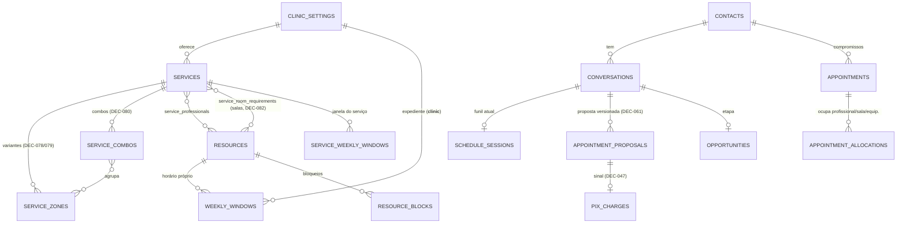
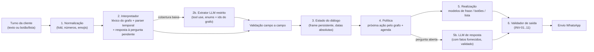

# Núcleo determinístico do atendimento conversacional

**Estado:** **Proposto**: análise de engenharia pedida pelo Paulo em 01/11/2026. O documento não altera decisões. Os pontos que exigem decisão estão na secção 10. Complementa o [modelo híbrido](conversational-hybrid-model.md) (a IA interpreta, o backend decide), o [plano de testes](../implementation/plano-testes-conversacional.md) e a [matriz de diálogos](../implementation/matriz-dialogos-conversacional.md). Todos os exemplos são fictícios.

**Tese:** quase tudo o que o atendente precisa de decidir está no **grafo de dados da clínica**: serviço, variantes, linha, combos, profissionais, salas, janelas, bloqueios, Tempo, sinal, compromissos e propostas. Uma conversa de marcação é um percurso nesse grafo até um nó «horário livre». Esse percurso pode ser conduzido por **código determinístico**. O LLM fica onde acrescenta valor: entender texto que o léxico não cobre e responder a perguntas abertas. Esta mudança também resolve a tensão da NC-01, porque o texto livre do LLM deixa de ser o caminho normal de envio (secção 10).

## 1. Diagnóstico do modelo atual

| Situação | Caminho hoje | Problema |
| --- | --- | --- |
| Interpretar a mensagem | Regex em 7 módulos, com definições divergentes (CA-01) | Cada correção diverge das outras; maior parte dos CF-02 a CF-13 |
| Saber o que já foi dito | Releitura de 20–40 mensagens a cada turno + `schedule_sessions` parcial (CA-02) | Perguntas repetidas; sessão com **dia relativo** (CF-21) |
| Saber o que **o sistema** ofereceu | Regex sobre o **texto da própria mensagem enviada** (`zonesOfferedToClient`, marcador `RESCHEDULE_OFFER_MARKER`) | Uma mudança de redação quebra a lógica (CF-22) |
| Preço de serviço simples, «como funciona», oferta de horários de serviço sem variantes | LLM (`catalogReply` devolve `null` para serviços sem variantes) | Custo, latência e risco factual (CF-01) num caso trivial |
| Decidir a proposta | Depois da chamada ao LLM; o texto gerado é descartado (CA-03) | Até 25 s e tokens desperdiçados |
| Escolher entre opções fechadas (linha, zona, horário) | Texto livre da cliente + regex | «o das 14», «a segunda», «👍» falham (A-07, A-08, C-05) |
| Leituras por turno | `listServices`, `listResources` e `listMessages` repetidos em vários módulos no mesmo turno, e horários de 7 dias de **todos** os serviços calculados para o prompt | Trabalho repetido no DO, prompt grande |

**Achados novos, acrescentados ao plano:**

- **CF-21 (S2):** o dia guardado na sessão é relativo. Se a cliente disse «amanhã» numa quinta às 23:50 e respondeu «14h» às 00:05 de sexta, o sistema resolve «amanhã» no dia da resposta e propõe **sábado**. Fonte: `autobook.ts:530–531`, `reschedule.ts:197–198`; migração `0044_schedule_session.ts` (`day_label`).
- **CF-22 (S3):** a lógica depende da redação das mensagens já enviadas pelo próprio sistema.

## 2. O grafo da clínica (SQLite do DO, DEC-038)



Cada nó **restringe a conversa** e diz o que perguntar, o que saltar e o que oferecer:

| Nó / atributo | Efeito na conversa |
| --- | --- |
| `services` (ativo, `audiencia`) | Conjunto de serviços elegíveis; a audiência filtra o catálogo, não a pessoa (DEC-075). |
| `service_zones` vazio | Não há passo de variantes; duração e preço são os da linha. |
| `service_zones` com variantes `feminino` **e** `masculino` | Há passo de linha (DEC-079/090). Se todas são de um género ou `ambos`, o passo **não existe**. |
| Uma única variante ativa na linha | É escolhida implicitamente; não se pergunta. |
| `service_combos` | Preço da visita (`priceVisit`/`bestCombo`); opção «todas» natural. |
| `service_professionals` com 1 profissional | Não se pergunta por profissional; o pedido de outra vai à equipe. |
| `service_professionals` com N profissionais | A preferência da cliente é um **filtro** da disponibilidade (`queryAvailability` já aceita `professionalId`, CF-20). |
| Salas, equipamento, capacidade, `sameSexInSlot` | Invisíveis à cliente (DEC-090); só reduzem os horários. |
| `weekly_windows`, `service_weekly_windows`, `resource_blocks`, `appointment_allocations` | Definem os horários reais; a conversa oferece só nós alcançáveis. |
| `tempo*` (DEC-077) | Filtra os horários automáticos; frase fixa quando falha. |
| `requiresSignal` | O fim do percurso é o Pix, não a marcação. |
| `appointments` futuros do contato | Mudam o sentido de «posso para quarta?» (remarcação, DEC-091). |
| `appointment_proposals` vigente | Mudam o sentido de «não, 16h» (nova versão) e de «sim». |

**Consequência:** a ordem das perguntas e as opções válidas em cada passo **calculam-se** a partir do grafo. Não precisam de ser inferidas por um modelo nem codificadas à mão por caso.

## 3. Arquitetura proposta: um único pipeline por turno



### 3.1 Normalização (determinística)

Uma única função `normalizeTurn`, usada por todos os módulos:

- fold de acentos e caixa;
- números por extenso («duas», «três», «meio-dia»);
- emojis de aceite (👍, ✅) viram um token `AFIRMA`;
- abreviaturas comuns («blz», «vc», «amanha»);
- separação das bolhas do turno, que se juntam como hoje com o debounce.

O turno inteiro é lido, não só a última mensagem (CF-13).

### 3.2 Interpretador (determinístico primeiro)

O interpretador produz um **ato** com campos, cada um com a sua origem `{messageId, trecho, fonte: regra|botão|llm}`:

```ts
type TurnInterpretation = {
  acts: Array<'marcar' | 'informar_preco' | 'informar_horario_funcionamento' | 'informar_local'
    | 'explicar' | 'escolher_opcao' | 'afirmar' | 'negar' | 'corrigir' | 'adiar' | 'pedir_pessoa'
    | 'remarcar' | 'cancelar' | 'saude' | 'terceiro' | 'ofensa' | 'injecao' | 'cumprimento' | 'desconhecido'>
  slots: {
    serviceId?: Field<string>; line?: Field<'feminino' | 'masculino'>; variantIds?: Field<string[]>
    professionalId?: Field<string>; date?: Field<string /* YYYY-MM-DD */>; period?: Field<'manha' | 'tarde' | 'noite'>
    time?: Field<string /* HH:MM */>; optionIndex?: Field<number>
  }
  coverage: number // fração de tokens explicada; abaixo do limiar → 2b
}
```

Componentes:

- **Léxico da clínica, compilado do grafo** e guardado em cache pela versão do catálogo: nomes de serviço, variantes, combos e profissionais, com tolerância a 1 erro de digitação por palavra (já existe `citesServiceName`). **Proposto:** sinónimos e nomes populares por serviço e variante, editáveis só pela owner (DEC-042). O LLM pode **sugerir** sinónimos offline a partir dos casos não reconhecidos; a owner aprova.
- **Parser temporal único**, que substitui `extractDates` e `extractTimes` nos 4 módulos. Datas absolutas resolvidas **no instante da mensagem**:
  - «próxima/que vem»;
  - mês por extenso;
  - dia da semana + data, conferidos entre si;
  - «meio-dia»;
  - «3 da tarde»;
  - «15 e 30»;
  - vizinhança de «R$/reais/custa/dura» exclui a leitura como hora;
  - validação de data civil.

  Testes por tabela e de propriedade. Uma biblioteca como chrono-node (que tem português) pode ser avaliada, mas fica atrás da mesma tabela de testes.
- **Resposta à pergunta pendente:** quando o sistema faz uma pergunta fechada, o estado guarda `pending = {slot, opções[]}`. A resposta seguinte é interpretada **primeiro contra essas opções**: «a segunda», «o das 14», «essa», «👍» com uma única opção, «sim». É a técnica mais eficaz contra o «sim» deslocado (C-06), porque «sim» só confirma quando a pergunta pendente era sim/não sobre aquilo.
- **Classificador único de tópico sensível e handoff:** uma só lista para saúde, ofensa, terceiro, cancelamento e pedido de pessoa, com a política da DEC-046 e da DEC-083. Elimina CF-02, CF-03, CF-04 e CF-18. A suspeita de injeção vira um sinal com níveis; só o nível forte pausa.

**2b. Extrator LLM restrito (fallback):** só entra quando `coverage` fica abaixo do limiar ou há ato `desconhecido`. Usa *tool use* com schema estrito, em que os **enums são os ids do grafo** (serviços, variantes, profissionais). O modelo não consegue nomear o que não existe. A data volta como texto literal citado e é resolvida pelo parser determinístico. Recebe só o turno, a pergunta pendente e os nomes do catálogo, sem agenda nem histórico longo (minimização, NC-02). O backend valida cada campo (modelo híbrido §2). A confiança do modelo nunca autoriza.

### 3.3 Estado do diálogo (frame persistente)

O frame substitui `schedule_sessions` e a releitura do histórico. É uma linha por conversa, gravada na mesma transação que a mensagem de saída:

```ts
type BookingFrame = {
  phase: 'idle' | 'coletando' | 'ofertado' | 'proposto' | 'pix_pendente' | 'remarcando' | 'pausado'
  serviceId: string | null; line: 'feminino' | 'masculino' | null; variantIds: string[] | null
  professionalPref: string | null
  date: string | null          // absoluta (corrige CF-21)
  period: 'manha' | 'tarde' | 'noite' | null; time: string | null
  pending: { slot: string; options: Array<{ key: string; label: string }>; messageId: string } | null
  lastOffer: { slots: Array<{ startsAt: number; professionalId: string }>; messageId: string } | null  // corrige CF-22
  proposal: { id: string; version: number } | null
  rescheduleAppointmentId: string | null
  catalogVersion: string        // mudança de catálogo → revalidar ids
  provenance: Record<string, { messageId: string; source: 'regra' | 'botao' | 'llm' }>
}
```

Regras do frame:

- trocar de serviço limpa a linha, as variantes e a hora (como hoje);
- uma proposta nova invalida a anterior (DEC-061);
- o frame é limpo quando a marcação é concluída (DEC-086);
- o frame é da conversa e não do contato (DEC-079: nada sobre a pessoa).

### 3.4 Política: a próxima ação calculada pelo grafo

Ordem de decisão (determinística, testável por tabela):

1. **Handoff** (DEC-083): pedido de pessoa, saúde, terceiro, cancelamento, profissional fora do serviço. Frase fixa e pausa, sem modelo.
2. **Perguntas informativas** (preço, duração, expediente, local, quem faz, explicação cadastrada, política): resposta tirada do grafo. Se há funil aberto, a mesma mensagem termina com **a** pergunta seguinte do funil (uma só).
3. **Funil de marcação.** Pergunta-se apenas o que muda a disponibilidade ou o preço e que o grafo não determina sozinho:
   1. serviço, se for ambíguo (opções fechadas);
   2. linha, só se existirem variantes dos dois géneros;
   3. variantes, só se houver mais de uma na linha; os combos e «todas» entram como opções;
   4. **sem dia ou hora: oferecer logo os 2–3 horários reais mais próximos** que respeitem o que já foi dito (período, dia, profissional), em vez de perguntar «qual dia?» (iniciativa mista; CF-19);
   5. hora escolhida e livre → **proposta versionada** (DEC-061);
   6. hora não livre → alternativas mais próximas no mesmo período e, sem nenhuma, no próximo dia com vaga (CF-15).
4. **Correção e mudança** («não, 16h», «prefiro massagem»): atualizar o frame e voltar ao passo 3, com nova versão da proposta se ela já existia.
5. **Adiar** («vou pensar»): frase de acolhimento, nenhuma pergunta e só o idle da DEC-087 depois.
6. **Desconhecido** depois do 2b: pergunta de esclarecimento com as opções do passo atual e o botão da equipe. Nunca silêncio (CF-14).

### 3.5 Realização: frases naturais sem LLM

As frases fixas atuais soam a sistema («Para fechar às 14:00, me diga as Zonas»). A naturalidade vem de quatro técnicas determinísticas:

- **Eco (confirmação implícita):** começar por repetir o que foi entendido, o que também permite à cliente corrigir. Ex.: «Perfeito, axila e pernas na linha feminina.»
- **Variação controlada:** 3–5 redações aprovadas por ato, escolhidas por hash da conversa (estáveis no replay e nos testes), nunca ao acaso em produção.
- **Primeiro nome** só no primeiro contato ou depois de uma pausa longa; persona da DEC-089 na concordância.
- **Uma pergunta por mensagem**, sem jargão (lista INV-05). Plural do tipo em minúsculas.

Exemplo do mesmo funil (fictício):

| Hoje (frases atuais e LLM) | Proposto (modelos de frase + botões) |
| --- | --- |
| C: «Quero depilação» → A: «Depilação feminina ou masculina?» → C: «feminina» → A: «Qual zona? Axila, Pernas, Buço» → C: «axila e pernas» → A: [LLM] «Qual dia fica melhor?» → C: «sexta de manhã» → A: «Para Axila e Pernas, de manhã tenho sexta 06/11 às 09:00, 10:00. Qual fica melhor?» → C: «10h» → proposta. **5 turnos.** | C: «Quero depilação» → A: «Claro! É na linha feminina ou masculina?» [Feminina] [Masculina] → C: toca *Feminina* → A: «Quais zonas? Pode escolher mais de uma.» [lista: Axila · Pernas · Buço · Todas] → C: «axila e pernas» → A: «Perfeito, axila e pernas. Os próximos horários são sexta 09:00, sexta 10:00 ou segunda 14:00. Algum serve?» [lista de horários] → C: toca *sexta 10:00* → proposta. **4 turnos, 0 chamadas ao LLM e 2 respostas sem possibilidade de erro de interpretação.** |

**Botões e listas do WhatsApp:** hoje só existem botões de resposta (proposta, handoff, follow-up). Acrescentar mensagens de **lista** para horários e variantes. Pelos limites da Meta, a confirmar na documentação vigente: até 10 linhas e títulos curtos. Um toque é um evento autenticado e sem ambiguidade (como o `button_reply` da S5). **Não** substitui o Confirmar da proposta (DEC-061): escolher o horário apenas monta a proposta. A cliente continua a poder escrever livremente; os botões são atalho, não obrigação.

**5b. LLM de resposta**, só para atos que o grafo não responde, como uma pergunta fora do catálogo («fazem pacote para noivas?»). Recebe os fatos já calculados e o ato pedido. A saída passa pelo validador factual (CF-01). Se falhar, sai a frase fixa com o botão da equipe. Com isto, o texto livre do LLM passa a ser exceção e não o caminho normal.

### 3.6 Validador de saída (para tudo o que sai)

O validador aplica-se a modelos de frase **e** ao LLM:

- preço igual ao `quoteVisit` do frame;
- horário pertence a `lastOffer` ou à disponibilidade atual;
- serviço e variantes existem;
- nenhuma afirmação de reserva sem compromisso;
- nenhum termo interno;
- formato WhatsApp.

Nos modelos de frase serve de rede contra regressões; no LLM é o gate (INV-01..11 do plano).

## 4. O que passa de LLM para determinístico

Estimativa qualitativa. A medição faz-se com o evento `ai.turn_decided` (CA-09) e a métrica EE-06.

| Tipo de turno | Hoje | Proposto |
| --- | --- | --- |
| Cumprimento / abertura sem pedido | LLM | Modelo de frase («Oi, Carla! Sou a Lia, da clínica. Quer agendar algum serviço?») + lista de serviços se forem poucos |
| Preço de serviço simples | LLM | Grafo (`priceCents`, duração) |
| Preço de variantes / combo | Determinístico | Determinístico (mantém) |
| «Como funciona X?» | LLM, limitado a repetir a explicação cadastrada | Envia a explicação cadastrada (DEC-046 já limita a isso); sem explicação → frase fixa |
| Expediente, local, quem faz | Determinístico / LLM (local) | Determinístico (endereço e link cadastrados) |
| Disponibilidade de serviço sem variantes | LLM com horários de 7 dias de todos os serviços no prompt | Política 3.4 → `queryAutomaticAvailability` do serviço em jogo |
| Linha, variantes, hora, proposta | Determinístico (com o LLM chamado antes e descartado) | Determinístico, sem chamada |
| Remarcação (DEC-091), handoff (DEC-083), Tempo | Determinístico | Determinístico (mantém) |
| Texto confuso, coloquial ou fora do léxico | LLM escreve resposta livre | LLM **extrai** campos (2b) e o código decide e responde |
| Pergunta aberta fora do grafo | LLM | LLM com fatos fornecidos e validador (5b), ou equipe |
| Resumo para a equipe | LLM | LLM (mantém; interno) |

**Hipótese a medir:** o LLM passa de quase todos os turnos que não são proposta para uma minoria, os de cobertura baixa e as perguntas abertas. A latência típica passa a ser o debounce mais milissegundos. O custo cai na mesma proporção. Não há número fixado antes da linha de base.

## 5. Eficiência no DO

- **`TurnContext` único por turno:** catálogo, recursos, sessão, compromissos futuros e as últimas mensagens lidos **uma vez** e passados aos módulos. O **catálogo compilado** (léxico, variantes por linha, combos) fica em memória do DO por `catalogVersion` e é invalidado quando a owner grava.
- **Disponibilidade só do serviço e variantes em jogo**, para o dia ou período pedido, ou até encontrar 3 horários. Acaba com os horários de 7 dias × todos os serviços.
- **Debounce adaptativo (Proposto):**
  - toque em botão ou lista: 0 s, porque a resposta é completa;
  - mensagem que fecha o frame: ≈2–3 s;
  - texto aberto: 7 s (atual).
- **Paralelismo limitado entre conversas** no alarme, com ordem preservada dentro de cada conversa (CA-06).
- **LLM:** *prompt caching* no bloco estável, extrator com contexto mínimo, modelo pequeno para extração. A escolha de modelo decide-se na matriz L2 (CA-07).

## 6. Robustez: testes gerados a partir do grafo

- **Geração de diálogos pelo grafo:** para cada clínica de teste, enumerar os percursos serviço → linha → variantes → (dia, período, hora) × (livre, ocupado, fechado, Tempo, sinal). Cada percurso vira um diálogo L1 com o resultado esperado calculado pelo próprio grafo. Complementa a matriz manual e cobre combinações que ninguém escreveria à mão.
- **Lint de configuração** na tela «Conferir configuração» (M-52, DEC-085). Detetar percursos sem saída:
  - serviço sem profissional;
  - variante sem preço com o sinal em percentagem;
  - linha sem variantes ativas;
  - serviço cuja janela não cruza o expediente de nenhuma profissional;
  - sala sem horário.

  Antes de a IA atender, a owner vê «este serviço não consegue ser marcado pela conversa». **Proposto**, exige DEC de UX.
- **Propriedades** (testes de propriedade sobre o frame):
  - nenhuma pergunta sobre um slot já preenchido;
  - todo o horário ofertado pertence à disponibilidade;
  - toda a transição de fase é válida;
  - replay do mesmo turno = mesma saída (idempotência, hash da variação).
- **Diferencial:** correr o pipeline novo em **sombra** ao lado do atual (sem enviar) e comparar as ações por turno antes de trocar (avaliação contínua §5).

## 7. Fluidez e naturalidade: o que se preserva

| Risco do determinismo | Mitigação |
| --- | --- |
| Soar a robô | Eco + variação controlada + persona; textos escritos e revistos como copy (rubrica Q do plano). |
| Rigidez diante de texto livre | Botões são atalho; o texto continua aceite; extrator LLM para o que o léxico não cobre. |
| Ignorar uma pergunta lateral no meio do funil | Ato `informar_*` responde primeiro e depois retoma o funil numa só mensagem. |
| Perguntas a mais | Política só pergunta o que muda disponibilidade ou preço; oferta proativa de horários. |
| Insistência | Ato `adiar` encerra a iniciativa até ao idle (DEC-087). |

## 8. Migração incremental (cada passo com casos da matriz)

| Passo | Mudança | Casos que passam a verde | Risco |
| --- | --- | --- | --- |
| M1 | `TurnContext` + normalização + parser temporal único + classificador único de handoff | B-01–B-08, C-01–C-03, C-11, C-12, E-06, G-02, G-03, G-05, G-11, H-02, H-03 | Baixo (substitui funções equivalentes) |
| M2 | Frame com datas absolutas, `pending` e `lastOffer` estruturados (migração do `schedule_sessions`) | A-07, A-08, C-05, C-06, C-08, CF-21, CF-22 | Médio (migração de esquema por DO) |
| M3 | Ordem decidir → gerar; política 3.4 com oferta proativa e alternativas próximas | A-02, A-06, A-12, D-01, D-02, F-08 | Médio |
| M4 | Modelos de frase com eco e variação; validador de saída; fallback anti-silêncio | I-07, I-08, J-04, J-08, J-09, K-01, D-04 | Baixo |
| M5 | Mensagens de lista e botões para linha, variantes e horários | Menos turnos (EE-01) | Médio (contrato Meta; exige decisão) |
| M6 | Extrator LLM restrito (2b) e LLM de resposta (5b); retirar o prompt monolítico | Texto coloquial (L3) | Médio |
| M7 | Testes gerados pelo grafo + lint de configuração | Cobertura de catálogo | Baixo |

Cada passo corre primeiro em sombra e só depois troca o caminho (avaliação contínua §5). O passo regista-se como iteração no [plano de testes](../implementation/plano-testes-conversacional.md#7-registo-de-iterações).

## 9. Métricas esperadas (a confirmar na linha de base)

| Métrica | Efeito esperado |
| --- | --- |
| EE-06 chamadas ao LLM por episódio e chamadas descartadas | Queda forte; as descartadas vão a 0 |
| EE-04 latência p95 | Sem os 25 s do modelo nos turnos determinísticos |
| EE-01 turnos excedentes e EE-02 perguntas repetidas | Queda (oferta proativa, pergunta pendente, frame) |
| INV-02/03/04 | Garantidas por construção nos turnos determinísticos e pelo validador no LLM |
| Rubrica Q3/Q4 (tom, continuidade) | **Risco:** controlar com revisão de copy e variação; não pode descer mais de 0,2 |

## 10. Decisões em aberto

| Pergunta | Opções | Responsável | Bloqueia |
| --- | --- | --- | --- |
| ~~Modelos de frase determinísticos passam a ser o caminho normal, com o LLM só em 2b/5b?~~ | **Decidido: DEC-104 (Paulo, 01/11/2026), opção A.** | Paulo | Desbloqueia M3 e M4; M6 depende ainda da NC-02 |
| Listas e botões de escolha (linha, variantes, horários) antes da proposta | **Adiado:** decidir depois da linha de base e da iteração 1. | Paulo | M5 |
| ~~Sinónimos editáveis pela owner~~ | **Decidido: DEC-110.** | Paulo | — |
| ~~Lint de configuração na M-52~~ | **Decidido: DEC-112** (informativo). | Paulo | — |
| ~~Debounce adaptativo~~ | **Decidido: DEC-111.** | Paulo | — |
| ~~Contexto do extrator LLM~~ | **Decidido: DEC-109** (NC-02 só em parte). | Paulo | — |
