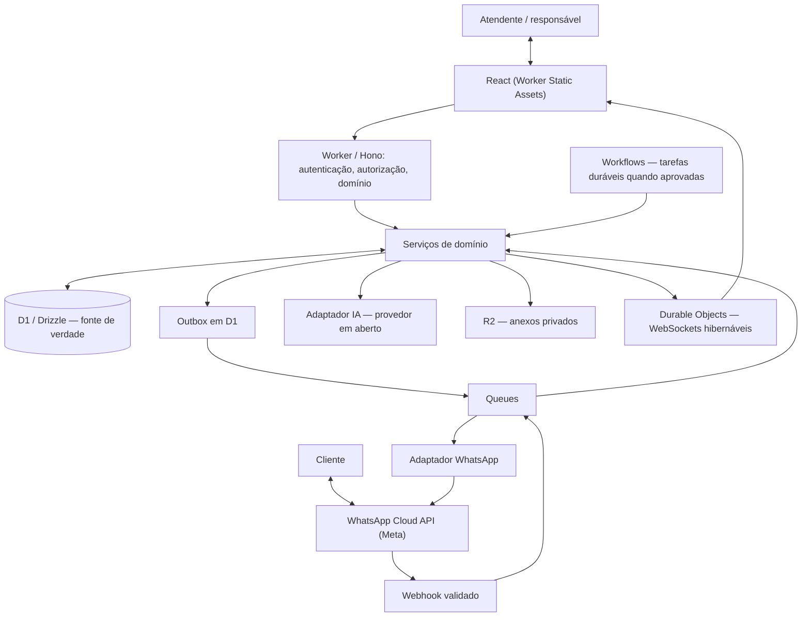

# Arquitetura de referência — Tredane

**Estado:** arquitetura de referência para o MVP (23/10/2026). Componentes confirmados constam em [MVP](../MVP.md); mecanismos de implementação específicos abaixo são **propostos** e sujeitos a validação. Este documento não comprova que o software já exista.

## Objetivo e fronteiras

Uma clínica piloto usa o painel para receber conversas WhatsApp, gerir oportunidades e reservar profissionais + salas/equipamentos sem conflito. A equipa recebe sugestões de IA e decide explicitamente se envia uma resposta. A aplicação é multi-tenant e atualiza Inbox, Pipeline e Agenda em tempo real.

### Mapa lógico

A Meta é um serviço externo indispensável; "Cloudflare-native" descreve a infraestrutura controlada pelo Tredane, não significa que WhatsApp ou um provedor de IA externo sejam hospedados pela Cloudflare.

## Módulos do monólito modular

- **identity/tenancy:** sessão autenticada, associações de membros, papéis, revogação e contexto de tenant.
- **channels/whatsapp:** associação de número, verificação de assinatura do webhook, tradução de estados e política de envio.
- **inbox:** contactos, conversas, mensagens, atribuição e envio humano.
- **pipeline:** oportunidades, etapas e histórico de mudanças.
- **scheduling:** serviços, profissionais, recursos físicos, regras de disponibilidade, agendamentos e conflitos.
- **ai-assist:** contexto mínimo por tenant, sugestão e resumo para revisão humana; sem envios autónomos.
- **realtime:** eventos após persistência, Durable Objects e reconciliação por API.
- **platform:** auditoria, outbox, idempotência, filas, recuperação de falhas e métricas técnicas.

Não dividir em microserviços no MVP. A API publica contratos tipados entre módulos; o D1 permanece a fonte de verdade dos dados de negócio.

## Identidade e administração (decisões confirmadas)

Clerk autentica as sessões, **sem Organizations**. Memberships N:N e roles por tenant vivem no D1; o mesmo usuário pode alternar clínicas sem elevar privilégios. A Platform Admin é uma superfície separada autorizada por `privateMetadata.superadmin === true`, consultado no backend.

Para suporte, o Tredane emite **suas próprias sessões temporárias** em D1, associadas à sessão Clerk do administrador real (**actor**), ao usuário membro (**subject**), tenant, motivo e prazo. A Clinic App aplica a role do subject e limitações de suporte; a auditoria mantém actor e subject distintos. Não se cria uma sessão Clerk do usuário alvo. Handoff, MFA, revogação e permissões de manutenção devem ser validados antes de dados reais.

Ver [ADR-0006](../adr/0006-clerk-platform-admin.md), [ADR-0007](../adr/0007-support-impersonation.md) e [identidade](identity-and-admin.md).

## Fluxos transacionais

**Entrada WhatsApp:** verificar assinatura e identificar integração → normalizar envelope com tenant e ID externo → persistir evento ou chave de deduplicação → publicar para Queue → processar idempotentemente → persistir contacto/conversa/mensagem → registar mudança relevante para publicação em tempo real. A resposta HTTP ao webhook não depende de inferência IA.

**Saída humana:** utilizador autenticado confirma texto → autorização por tenant → registar intenção de envio/outbox no D1 → despachar via Queue → solicitar envio à Meta → armazenar resultado (pendente, aceite, entregue, lido, falhou ou desconhecido). Resultado incerto exige reconciliação antes de novo envio. Estado aceite pela Meta não equivale a entregue.

**Agenda:** validar serviço, regras e todos os recursos requeridos → transação D1 verifica e ocupa intervalos de profissional e sala/equipamento → persistir agendamento + auditoria/outbox → publicar evento. Consulta de horários é apenas uma prévia; a gravação faz a verificação definitiva. Ver [modelo de dados](data-model.md).

**Tempo real:** após commit, um publicador lê a outbox, envia evento com tenant e ID de entidade ao Durable Object da clínica; o objeto distribui apenas às sessões autorizadas. O painel relê API quando conecta/reconecta, e nunca considera o WebSocket fonte de verdade. A revogação de uma sessão deve impedir novas entregas, incluindo conexões hibernadas.

## Políticas de segurança

- Tenant derivado exclusivamente da sessão verificada ou do número de WhatsApp previamente associado à clínica; nunca confiar em tenant_id livre do cliente.
- Consultas e mutações D1 devem ser filtradas por tenant e usar associações verificadas; validar IDs relacionados com o mesmo tenant.
- WebSocket autenticado no upgrade, com revalidação após revogação/troca de clínica; no mínimo validar autorização antes de emitir dados a uma sessão.
- R2 com objetos privados sob prefixo por tenant e acesso mediado por API; não permitir links públicos permanentes.
- Queue/Workflows preservam tenant e identificador lógico, e revalidam pré-condições antes dos efeitos colaterais.
- Logs sem tokens, mensagens completas ou dados sensíveis desnecessários; retenção, exportação e exclusão são **em aberto** antes do piloto real.

Ver [fronteiras por tenant](../product/tenant-boundaries.md), [requisitos](../product/requirements.md), [estados](../product/states.md) e [ADRs](../adr/).

## Qualidade e observabilidade

Registrar correlation_id, tenant_id interno, entidade/ação, estado do evento, latência e falha sem conteúdo pessoal. Alertar para filas de falhas, outbox pendente, envio incerto, falhas do webhook, erros de agenda e WebSockets desconectados. Testes de contrato, isolamento A/B, replay de webhook, concorrência de agenda e reconexão são bloqueadores de release.

## Decisões ainda em aberto

Protocolo de sessão de suporte, topologia D1, conexão/onboarding dos números Meta, provedor de IA, retenção LGPD, granularidade e bloqueios da agenda, política de notificações e necessidade de introduzir Workflows já na primeira fatia. Não utilizar dados reais antes dessas políticas estarem aprovadas.
