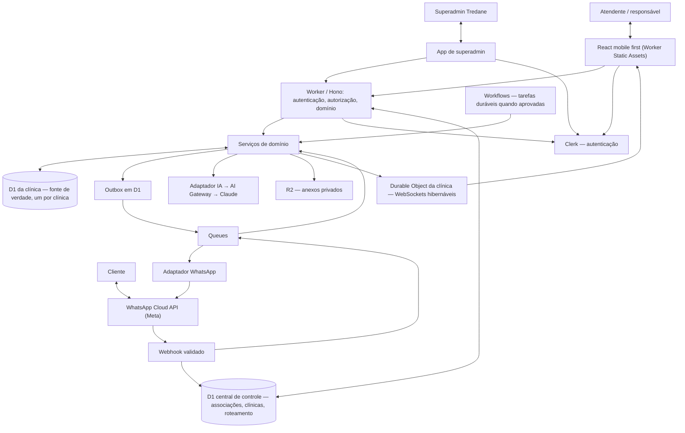

# Arquitetura de referência — Tredane

**Estado:** arquitetura de referência para o MVP (23/10/2026), atualizada com as decisões DEC-005 e DEC-007 a DEC-012 do mesmo dia. Componentes confirmados constam em [MVP](../MVP.md); mecanismos de implementação específicos abaixo são **propostos** e sujeitos a validação. Este documento não comprova que o software já exista.

## Objetivo e fronteiras

Uma clínica piloto usa o painel para receber conversas WhatsApp, gerir oportunidades e reservar profissionais + salas/equipamentos sem conflito. A equipa recebe sugestões de IA e decide explicitamente se envia uma resposta. A aplicação é multi-tenant e atualiza Inbox, Pipeline e Agenda em tempo real.

### Mapa lógico

A Meta é um serviço externo indispensável; "Cloudflare-native" descreve a infraestrutura controlada pelo Tredane, não significa que WhatsApp ou um provedor de IA externo sejam hospedados pela Cloudflare.

## Módulos do monólito modular

- **identity/tenancy:** autenticação pelo Clerk (código por e-mail), verificação do token no Worker, associações a uma ou mais clínicas e papéis no D1 central, seleção da clínica ativa, revogação imediata pelo D1 central e resolução clínica → D1.
- **control-plane:** criação de clínica, provisionamento e migração do D1 da clínica, convites e saúde técnica, exposto ao app de superadmin ([ADR-0006](../adr/0006-superadmin-control-plane.md)).
- **channels/whatsapp:** associação de número, verificação de assinatura do webhook, tradução de estados e política de envio.
- **inbox:** contactos, conversas, mensagens, atribuição e envio humano.
- **pipeline:** oportunidades, etapas e histórico de mudanças.
- **scheduling:** serviços, profissionais, recursos físicos, regras de disponibilidade, agendamentos e conflitos.
- **ai-assist:** contexto mínimo por tenant, sugestão e resumo para revisão humana; sem envios autónomos.
- **realtime:** eventos após persistência, Durable Objects e reconciliação por API.
- **platform:** auditoria, outbox, idempotência, filas, recuperação de falhas e métricas técnicas.

Não dividir em microserviços no MVP. A API publica contratos tipados entre módulos; o D1 de cada clínica é a fonte de verdade dos dados de negócio, e o D1 central só guarda dados de plataforma ([ADR-0002](../adr/0002-d1-topology.md)).

## Fluxos transacionais

**Entrada WhatsApp:** verificar assinatura e identificar integração → resolver `phone_number_id` → clínica → D1 da clínica no D1 central → normalizar envelope com tenant e ID externo → persistir evento ou chave de deduplicação → publicar para Queue → processar idempotentemente → persistir contacto/conversa/mensagem → registar mudança relevante para publicação em tempo real. A resposta HTTP ao webhook não depende de inferência IA.

**Saída humana:** utilizador autenticado confirma texto → autorização pela associação à clínica ativa → registar intenção de envio/outbox no D1 → despachar via Queue → solicitar envio à Meta → armazenar resultado (pendente, aceite, entregue, lido, falhou ou desconhecido). Resultado incerto exige reconciliação antes de novo envio. Estado aceite pela Meta não equivale a entregue.

**Agenda:** validar serviço, regras e todos os recursos requeridos → transação D1 verifica e ocupa intervalos de profissional e sala/equipamento → persistir agendamento + auditoria/outbox → publicar evento. Consulta de horários é apenas uma prévia; a gravação faz a verificação definitiva. Ver [modelo de dados](data-model.md).

**Tempo real:** após commit, um publicador lê a outbox, envia evento com tenant e ID de entidade ao Durable Object da clínica; o objeto distribui apenas às sessões autorizadas. O painel relê API quando conecta/reconecta, e nunca considera o WebSocket fonte de verdade. A revogação de uma sessão deve impedir novas entregas, incluindo conexões hibernadas.

## Políticas de segurança

- Tenant derivado exclusivamente da sessão verificada (clínica ativa com associação vigente) ou do número de WhatsApp previamente associado à clínica; nunca confiar em tenant_id livre do cliente.
- Cada requisição abre apenas o D1 da clínica resolvida; consultas continuam filtradas por tenant e validam IDs relacionados (defesa em profundidade).
- App de superadmin opera sobre o D1 central e metadados técnicos; não abre o D1 de clínicas para ler conteúdo. Suporte com conteúdo só por acesso temporário concedido pelo responsável (DEC-012). O papel de superadmin vem do metadado privado `superadmin: true` do Clerk, lido no servidor.
- O token do Clerk prova quem é o usuário; o acesso a uma clínica depende da associação vigente no D1 central, consultada a cada requisição e na abertura do WebSocket, o que permite revogação imediata.
- WebSocket autenticado no upgrade, com revalidação após revogação/troca de clínica; no mínimo validar autorização antes de emitir dados a uma sessão.
- R2 com objetos privados sob prefixo por tenant e acesso mediado por API; não permitir links públicos permanentes.
- Queue/Workflows preservam tenant e identificador lógico, e revalidam pré-condições antes dos efeitos colaterais.
- Logs sem tokens, mensagens completas ou dados sensíveis desnecessários. AI Gateway configurado sem registro de conteúdo. Retenção e exclusão seguem DEC-011 (exclusão de contato pelo responsável; exclusão total até 30 dias após o encerramento, facilitada pelo D1 por clínica), com revisão jurídica pendente.

Ver [fronteiras por tenant](../product/tenant-boundaries.md), [requisitos](../product/requirements.md), [estados](../product/states.md) e [ADRs](../adr/).

## Qualidade e observabilidade

Registrar correlation_id, tenant_id interno, entidade/ação, estado do evento, latência e falha sem conteúdo pessoal. Alertar para filas de falhas, outbox pendente, envio incerto, falhas do webhook, erros de agenda e WebSockets desconectados. Testes de contrato, isolamento A/B, replay de webhook, concorrência de agenda e reconexão são bloqueadores de release.

## Decisões ainda em aberto

Mecanismo para o Worker abrir o D1 de cada clínica e migrar todos os bancos ([ADR-0002](../adr/0002-d1-topology.md)); custo, plano e residência de dados do Clerk ([DEC-007](../product/decisions.md)); segundo fator do superadmin ([ADR-0006](../adr/0006-superadmin-control-plane.md)); revisão jurídica LGPD; verificação do Tredane como Tech Provider; política de notificações; necessidade de Workflows já na primeira fatia. Não utilizar dados reais antes dessas políticas estarem aprovadas.
